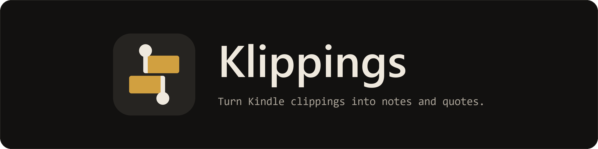
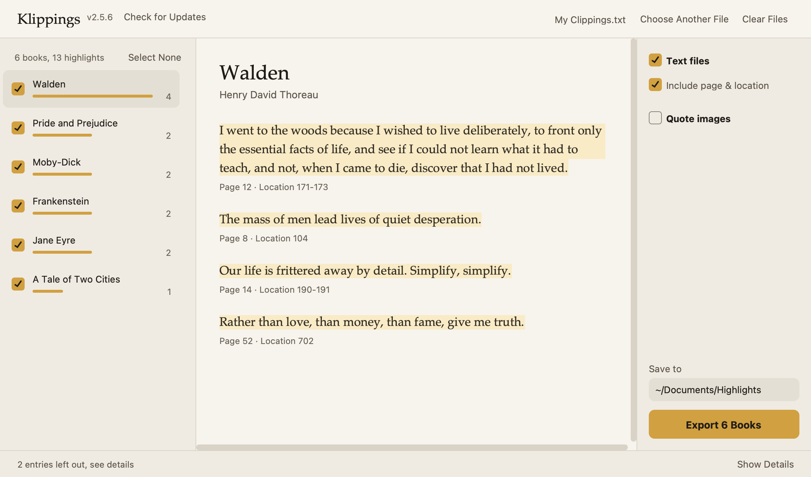
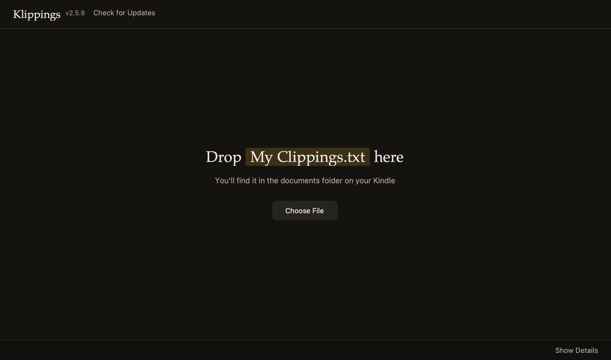
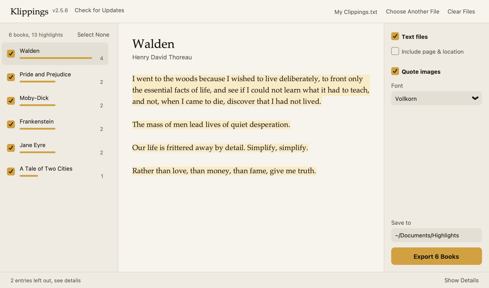
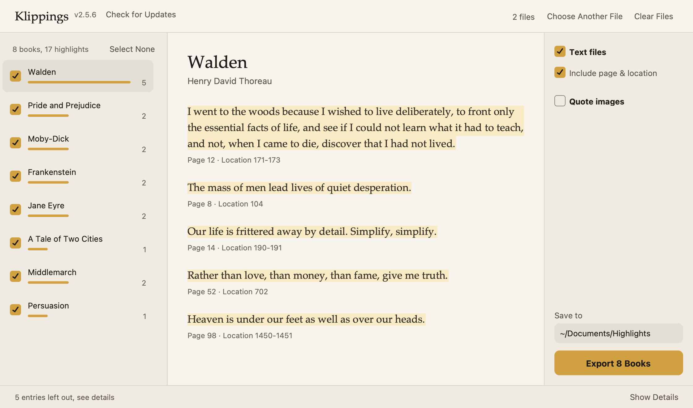

Klippings turns the highlights on your Kindle into a text file for each book, quote images, or both. Works offline. Sends no data. It goes online only when you select **Check for Updates**.

**Contents:** [What it does](#what-it-does) · [Privacy](#privacy) · [Download](#download) · [How to use](#how-to-use) · [For developers](#for-developers)

<picture>
  <source media="(prefers-color-scheme: dark)" srcset="assets/screenshots/main-dark.png">
  
</picture>

---

## What it does

Your Kindle records every highlight from every book in one file, `My Clippings.txt`. The file gets longer each time you highlight something. Klippings sorts it into one set of files per book. Your `My Clippings.txt` file is not changed.

```
My Clippings.txt   →   Walden.txt
                       Pride and Prejudice.txt
                       Moby-Dick.txt
```

### Drop in your clippings



Drop `My Clippings.txt` on the window. Your books and highlights appear at once, ready to read and export.

### Text files for each book

<picture>
  <source media="(prefers-color-scheme: dark)" srcset="assets/screenshots/images-and-simple-dark.png">
  
</picture>

Every book gets its own text file, ready for your notes. Keep the page and location of each highlight, or leave them out for a clean copy.

### Quote images


Each highlight becomes a 1080 x 1350 px image, ready to share. Long highlights are split across several images.

### Several files at once

<picture>
  <source media="(prefers-color-scheme: dark)" srcset="assets/screenshots/several-files-dark.png">
  
</picture>

Open clippings from several Kindles, or dated backups of one Kindle. Klippings combines them into one library and leaves out the copies.

---

## Privacy

- Klippings works offline. Everything it does with your clippings happens on your computer.
- It has no telemetry, analytics, crash reports or tracking.
- Your text files and quote images are saved only in the folder you choose.
- Your settings (the last folder you used) and the log file are saved in a `Klippings-data` folder next to the app. Klippings creates it when it first starts. Nothing is saved anywhere else, so to move Klippings to another folder or computer, move the app and `Klippings-data` together.
- The app keeps a log file, `Klippings.log`, in the `Klippings-data` folder. It records what the app does and any errors, including file names, to help fix problems. It never records the text of your highlights. It never leaves your computer unless you send it. To find it, select **Show Details**, then **View Logs**.
- If Klippings can't write next to itself, it tells you once and does not save your settings. Your exports are not affected.
- The app makes one network connection, and only when you select **Check for Updates**. It sends one request to GitHub (`api.github.com`) to read the latest release number. It sends no data about you or your files, and it keeps nothing. GitHub sees your IP address, as with any web request.
- **Report a Problem…** opens a page on GitHub in your browser. Nothing is sent until you submit it there.

---

## Download

Klippings runs on Windows (x64), macOS on Apple Silicon, and Linux (x64).

1. Open the [Releases](https://github.com/TariqMK/Klippings/releases/latest) page.
2. Download the file for your computer:

| Computer | File |
|---|---|
| Windows (x64) | `Klippings-<version>-windows-x64.exe` |
| macOS (Apple Silicon) | `Klippings-<version>-macos-arm64.zip` |
| Linux (x64) | `Klippings-<version>-linux-x64.tar.gz` |

> [!IMPORTANT]
> On macOS, move **Klippings** out of the `Downloads` folder before you open it, for example to `Applications` or `Documents`. If it runs from where it was downloaded, macOS can stop it from saving its settings.

3. Start Klippings:
   - **Windows:** run the `.exe` file. No installation is necessary.
   - **macOS:** open the `.zip` file, then open **Klippings**. The first time, follow [Opening on macOS](#opening-on-macos).
   - **Linux:** extract the `.tar.gz` file, then run `Klippings`.

### Opening on macOS

Klippings isn't notarised by Apple, so macOS shows a warning the first time you open it. This is expected and doesn't mean the app is harmful.

1. Open Klippings and click **Done** on the warning.
2. Open **System Settings → Privacy & Security**, scroll down to the message saying "Klippings" was blocked, and click **Open Anyway**.
3. Enter your password, then click **Open** on the next prompt. You only need to do this once.

<details>
<summary>If you use Terminal</summary>

You can run this instead:

    xattr -dr com.apple.quarantine "/Applications/Klippings.app"

</details>

---

## How to use

1. Connect your Kindle to your computer. Find `My Clippings.txt` in the `documents` folder on the Kindle.
2. Drop `My Clippings.txt` on the Klippings window, or select **Choose File**. To open several files, select or drop them together.
3. In the book list, tick the books to export. Use **Select All** or **Select None** to change all of them.
4. Select a book to read its highlights in the middle of the window.
5. In the export panel on the right, choose what to make:
   - **Text files**, with or without **Include page & location**.
   - **Quote images**, with a **Font**.
6. Under **Save to**, select the button and choose a folder.

> [!WARNING]
> If a file with the same name is already in the folder, Klippings asks before it replaces it. A replaced file can't be recovered.

7. Select **Export**. The button shows how many books it will export, for example **Export 6 Books**.
8. After the export, select **Show in Folder** to see the files.

To open different files, select **Choose Another File**. To close the open files, select **Clear Files**. Your export choices stay as they are.

### Text files

Klippings saves one text file per book, directly in the folder you choose. The file name is the book title without its subtitle.

| Include page & location | File name | Contents |
|---|---|---|
| Ticked (default) | `Walden.txt` | Each highlight, with its book, author, page and location |
| Cleared | `Walden (simple).txt` | The title and author, then each highlight, separated by `---` |

The reading view changes to show which version you will get.

`Walden.txt`:

```
1. The mass of men lead lives of quiet desperation.
	<Walden>(Henry David Thoreau) Your Highlight on page 8 | location 104-104

2. Our life is frittered away by detail. Simplify, simplify.
	<Walden>(Henry David Thoreau) Your Highlight on page 14 | location 190-191
```

`Walden (simple).txt`, for notes apps such as Obsidian:

```
Walden
Henry David Thoreau

---

1. The mass of men lead lives of quiet desperation.

---

2. Our life is frittered away by detail. Simplify, simplify.
```

### Quote image layout

Klippings saves each highlight as a WebP image, in a folder named after the book.

```
Walden/
├── Highlight_0001.webp
├── Highlight_0002_01.webp
└── Highlight_0002_02.webp
```

- Every image is 1080 x 1350 px, black text on white.
- The highlight is size 40, with line spacing 15, wrapped at 43 characters.
- The book and author line is size 27, at the bottom of the image.
- A highlight too long for one image is shared evenly across several images, such as `Highlight_0002_01.webp` and `Highlight_0002_02.webp`. Klippings breaks at the end of a sentence where one is close.
- Fine ticks at the top centre of split images show how many images there are. The darker tick shows the current image.
- Two fonts are included: Vollkorn and Platypi.

To export only images, clear **Text files** and tick **Quote images**.

### Opening several files

You can open clippings files from different Kindles, or dated backups of one Kindle, together.

- Books found in more than one file are combined into one book.
- A highlight in a later file is left out if its text, book, author, page, location and date all match one in an earlier file.
- Repeats inside one file are kept.
- Highlights are put in the order you took them: by date, then by location. If a book has a date Klippings can't read, that book is sorted by location only.

With one file open, highlights stay in the order of the file.

### What Klippings leaves out

Klippings exports highlights only. It leaves out these entries and shows how many of each it skipped:

- Bookmarks
- Notes
- Article clips
- Empty highlights
- Clipping limit messages
- Copies already in another file

Select **Show Details** in the status bar to see the counts.

### Keyboard shortcuts

On macOS, use `Cmd` in place of `Ctrl`.

| Shortcut | Action |
|---|---|
| `Ctrl+O` | Choose files |
| `Ctrl+Return` | Export |
| `Up` / `Down` | Move through the books |
| `Space` | Include or leave out the current book |
| `Esc` | Cancel an export |

On macOS, **Open…**, **Export** and **Clear Files** are also in the **File** menu.

### Check for updates

1. Select **Check for Updates**, next to the version number at the top of the window.
2. If a newer version is available, select **Yes** to open its download page in your browser.

Klippings does not download or install updates itself.

### Report a problem

1. Select **Show Details** at the bottom right of the window. On macOS, you can also use the **Help** menu.
2. Select **Report a Problem…**. A bug report opens on GitHub in your browser, with your Klippings version and system filled in.
3. Describe what happened, then select **Submit new issue**.

To add the log file to the report, select **View Logs**, then drag `Klippings.log` into the report. You can also [report a bug](https://github.com/TariqMK/Klippings/issues/new?template=bug.yml) or [suggest an idea](https://github.com/TariqMK/Klippings/issues/new?template=idea.yml) directly.

> [!NOTE]
> You need a free GitHub account to send a report.

### Known issues

- Amazon has changed the format of `My Clippings.txt` over the years. The common English formats are supported. Files from Kindles set to other languages are not supported yet, and their entries are counted as unrecognised. If you have a problem, please [raise an issue](https://github.com/TariqMK/Klippings/issues).
- A book with no author whose title ends in brackets, such as `Book (Vol 1)`, shows `Vol 1` as its author. The file format does not tell the two apart.
- If you extend a highlight on your Kindle, the old and new versions are both kept. The Kindle records them as separate highlights.
- Quote images use a fixed text size and line length. An unusually wide line, or a wider font, can come close to the edges of the image.

---

## For developers

Building the app yourself or changing it? Everything you need is below.

<details>
<summary><strong>Run from source</strong></summary>

Klippings needs Python 3.8 or later.

1. From the repository root, install Klippings and its libraries:

```
pip install .
```

2. Start the app:

```
klippings
```

> [!NOTE]
> From source, `Klippings-data` goes in the folder you start `klippings` from. With `python -m klippings` from a checkout, it goes in the repository root. Git ignores it.

From source, the app shows the development version, `v0.0.0.dev0`. Only release builds show a real version number. **Check for Updates** does not go online in a development build.

</details>

<details>
<summary><strong>Run the tests</strong></summary>

To run the tests:

```
pip install ".[dev]"
pytest
```

To check that the app has everything it needs, run the self-test. It prints `Klippings v0.0.0.dev0` and exits with code 0, or it lists what is missing and exits with code 1:

```
python -m klippings --self-test
```

To check the main features on made-up sample clippings, run the end-to-end check. It works only in a new, empty temporary folder. Add `--app` and the path to a built app to run that app's self-test as well:

```
python scripts/check_e2e.py
```

</details>

<details>
<summary><strong>Add a font for quote images</strong></summary>

1. Check that the font's licence allows it to be built into an app.
2. Put the `.ttf` or `.otf` file in `klippings/fonts`.
3. Put any licence file the font requires next to it.

The font appears in the **Font** menu. Vollkorn and Platypi are already there, with their licences.

</details>

<details>
<summary><strong>Update the screenshots</strong></summary>

The screenshots and the drag-and-drop GIF come from the real app, with sample clippings from public-domain books. Retake them after a change to the interface.

> [!IMPORTANT]
> The screenshot script runs on Windows, macOS and Linux (X11). It needs a screen of at least 2240 x 1380 px, or 1120 x 690 on a 2x display. On macOS, the app that runs it, such as Terminal, needs **Screen & System Audio Recording** permission. Do not cover the Klippings window while it runs.

1. Set `VERSION` at the top of `assets/make_screenshots.py` to the newest release tag.
2. From the repository root, run:

```
python assets/make_screenshots.py
```

The script writes the images to `assets/screenshots` and the GIF to `assets/gifs`.

To rebuild the app icons, the banner, the social card and the brand board after a change to the icon, tagline or colours, run:

```
python assets/make_assets.py
```

The script also copies the site icons and social card into `docs/`. The banner and social card use Windows fonts, so run it on Windows. The brand board (`assets/brand-board.png`) is drawn from `assets/brand.json` and needs PySide6 (`pip install PySide6`). Update `brand.json` when the app's colours change.

</details>

<details>
<summary><strong>Creating a Release</strong></summary>

1. Open the repository's **Actions** tab and select the **Release** workflow.
2. Run it on `main`, and choose:
   - **Release type:** `draft` or `public`
   - **Version increment:** `patch`, `minor` or `major`

The new version comes from the highest existing tag or release, including drafts. The app shows it, and the release is tagged with it. The workflow does not commit anything to `main`, so your local copy stays level with GitHub.

The workflow runs the tests first. It then starts each finished build once with `--self-test`. If the tests or a self-test fail, the workflow makes no tag and no release.

To add release notes, edit the release on GitHub. The workflow adds only a link to the full list of changes.

</details>

**Licence:** Klippings is free software under the [GNU General Public License v3.0](LICENSE). The bundled fonts, Vollkorn and Platypi, keep their own SIL Open Font License, in `klippings/fonts`.

_**Disclaimer:** Most if not all of the code here has been written in Python with the help of AI._
